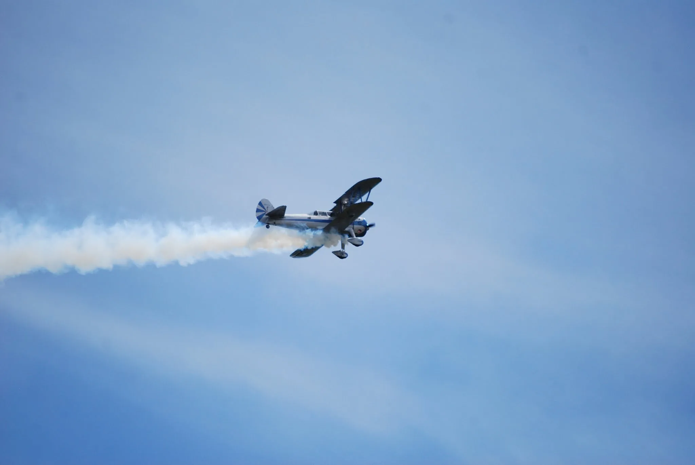
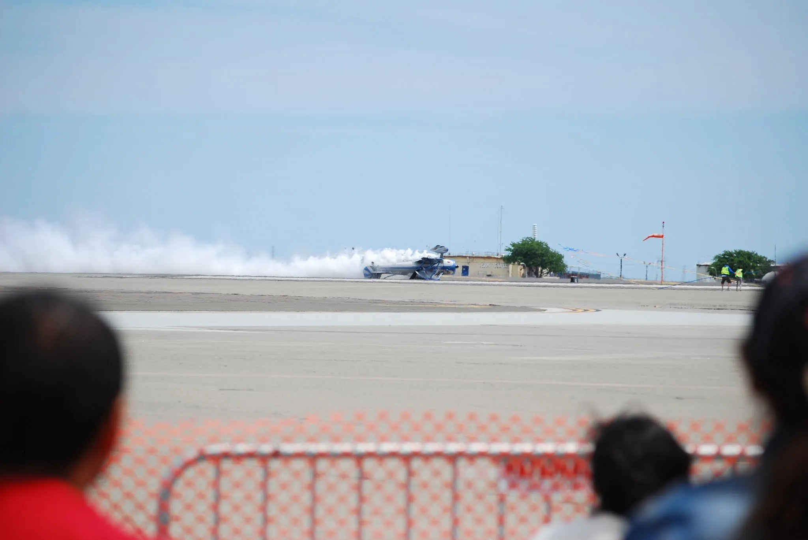
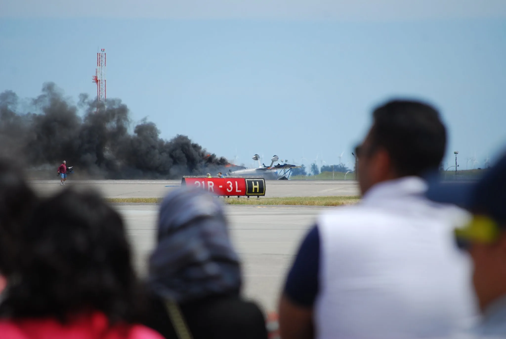
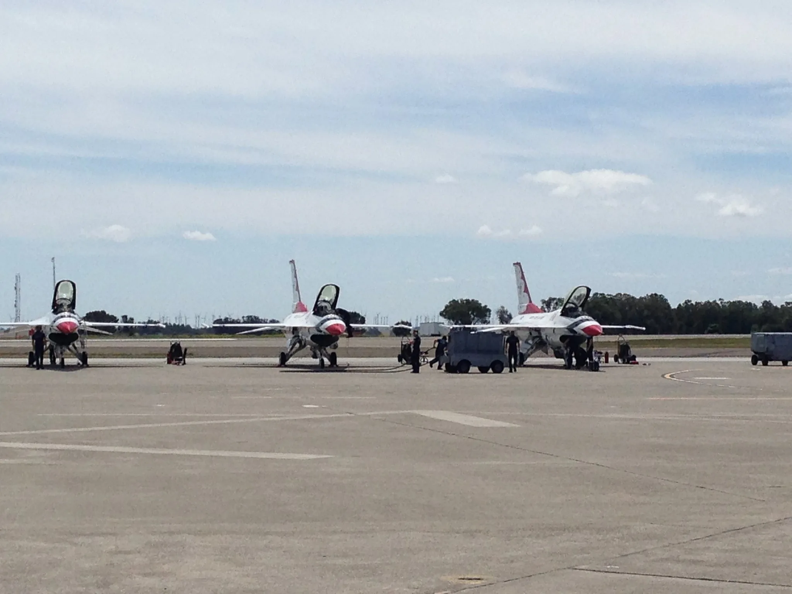
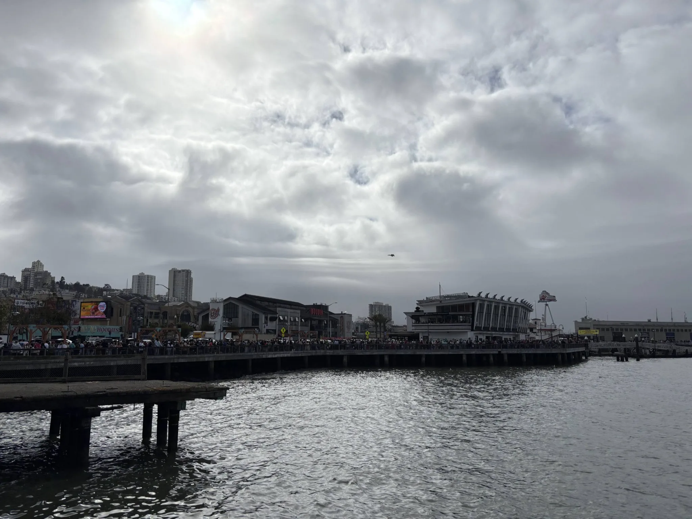
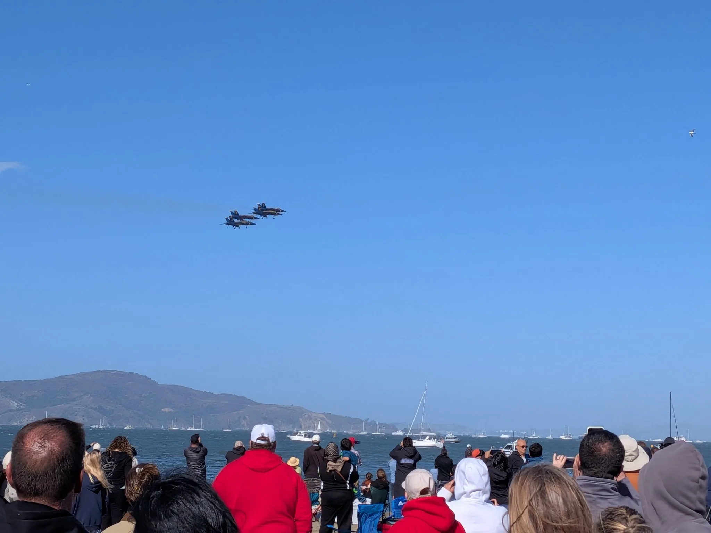
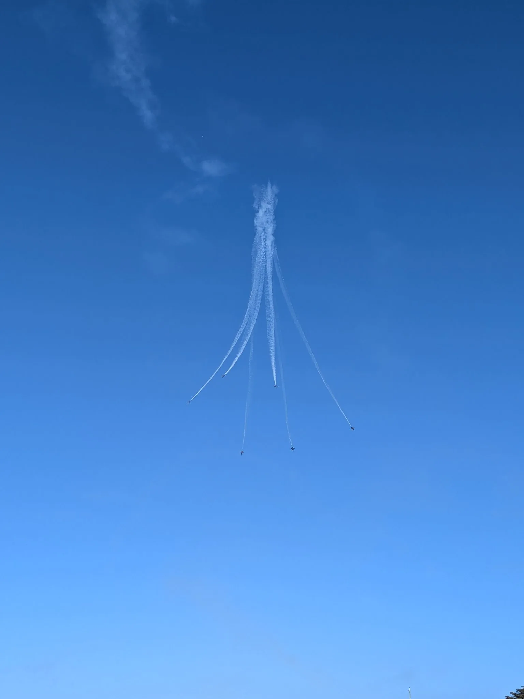

Yesterday I watched the Blue Angels fly over San Francisco Bay under a perfect blue sky. It was the third air show in a twelve-year story, and the first one where everything happened the way it was supposed to.

## 2014: the fire

Thunder Over Solano, Travis Air Force Base. We went as a family; the kid was too young to remember any of it. The Thunderbirds were headlining, but the civilian acts flew first, and one of them was Eddie Andreini — 77 years old, 11,400 hours, a well-known airshow pilot in the western US — in a 1944 Boeing Stearman biplane.

His stunt was the ribbon cut: a ribbon strung across the runway, the final pass flown inverted to slice it with the tail. He missed it on the planned pass, came around for another try, rolled inverted too early, and clipped the runway before he reached the ribbon. The plane slid upside down between the two ground crew holding the poles and caught fire. Then we all stood there — tens of thousands of us — and watched it burn while the fire trucks took their time getting there. The rest of the show was cancelled.

I remembered it as the plane gently touching down upside down and catching fire maybe thirty seconds later, probably a power loss. Years later I read the NTSB report, and the details are worse than I remembered. He survived the impact. But his canopy — a custom bi-fold design of his own, needing eighteen inches of clearance above it to open — couldn't open with the wreckage sitting inverted on the runway, and it had no emergency release. The cockpit wasn't even crushed. He was trapped, and died of burns. Toxicology found Benadryl and Zyrtec; the Board's probable cause was his failure to maintain clearance, impaired by the over-the-counter antihistamine. The fire crews took nearly five minutes.

## 2024: the clouds

A decade later we tried again: Fleet Week in San Francisco, back for the Blue Angels. The scouting flight went up, came back down, and the show was scrubbed — visibility unsafe for close formation flying. This photo is that survey flight, a lone jet in the overcast: the flight that cancelled the day for everyone on the pier.

## 2026: the redemption

Yesterday. Perfect blue sky, the show flew, and the whole thing finally happened the way the brochure promises. My son had zero interest in the fighter jets — but absolutely lit up for the United 777 flyby.

## The chain

Two Boeing investigations, twelve years apart: a 1944 biplane and a modern airliner. No single cause in either — ever. Just chains.

The Stearman's chain: a pill for allergies, a canopy added for comfort at 77 that became a trap, a precision stunt with no margin, fire crews not staged ready, an organizer's readiness decision. Each link defensible alone.

That report rewired how I read every accident after it. So years later, when the 737 MAX investigation came out, I read the whole thing the same way — looking for the chain, not the cause.

The MAX's chain starts further back, with Boeing's leadership and a culture shift toward cutting cost. The quick, cheap answer to the A320neo was to re-engine the 737 rather than design a new plane — but the bigger engines changed how it flew, so software (MCAS) was added to fake the old handling and protect the common type rating. That rating was the sales pitch: Boeing promised airlines no simulator retraining, just a short iPad course, with a million-dollars-per-plane penalty on the table if simulator time turned out to be necessary. Then a single angle-of-attack sensor with no backup, a system the pilots were never told about, and a regulator that had delegated too much of its oversight to the company it was supposed to watch. Lion Air, Ethiopian, 346 people.

I read most of the MAX investigation before a Hawaii trip right after the COVID lockdowns. We flew the MAX anyway. The fix was cheap — two sensors voting, one nudge per event, a disagree alert on the display, and telling pilots the system exists — which is exactly what made the original decisions sting.

Three air shows. The first ended in fire, the second in clouds, the third in blue sky. I'll take the blue sky.

## References

- [NTSB accident WPR14FA182 — report and communications timeline](http://www.kathrynsreport.com/2014/05/windy-travis-open-house-and-air-show.html)
- [NTSB accident WPR14FA182 — probable cause determination](http://www.kathrynsreport.com/2014_07_16_archive.html?m=1)
- [U.S. House Committee on Transportation and Infrastructure — final report on the 737 MAX, via the Congressional Record](https://www.congress.gov/congressional-record/volume-166/issue-195/house-section/article/H5835-1)
